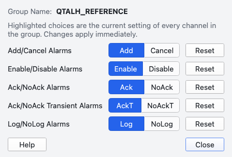
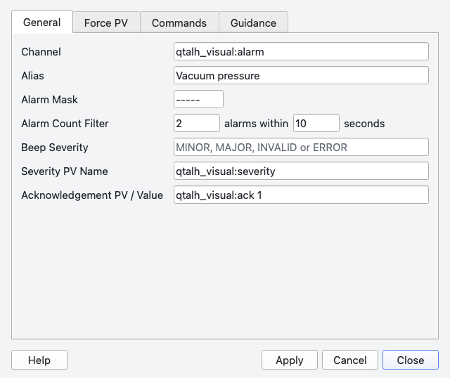

# QtALH appearance

## Modern appearance (default)

QtALH starts with a modern appearance designed to stay familiar to ALH operators.
The window layout, menus and menu items, keyboard shortcuts, row structure,
severity letters and colors, mask and count notation, and every dialog's
actions are the same as ALH's; only the presentation is updated. Use
`-style motif` for the classic Motif-influenced appearance described in the
historical sections below, or `-style fusion` (or another installed Qt Widgets
style) to apply that style's controls and the desktop palette to the modern
layouts. Both `-style name` and `-style=name` are accepted; names are
case-insensitive and the last occurrence wins. `-style modern` selects the
default explicitly.


Main window:

- The two alarm panes keep ALH's content-sized rows: acknowledge button,
  severity, name, disclosure arrow, G, P, mask, beep severity, and counts or
  channel alarm data, in that order. Acknowledge and severity are drawn as
  rounded color chips with ALH's letters; group names are bold.
- Selection is a tinted row with an accent edge, so alarm colors stay
  readable. Rows highlight under the pointer, and clicking anywhere on a row
  selects it; the controls keep their own actions and show a pointing cursor.
- Configured masks (anything other than `<----->`) and channel alarm data use
  the main text color; defaults and group counts are secondary.
- The panes are resized by dragging the divider. The classic width slider is
  shown only with `-style motif`.
- The status area keeps the same lines without frames: execution status,
  Disabled forcePVs and Shelved counts, the filename (selectable), and the
  collapsible **Alarm legend** on the left; silence controls, Silence Forever,
  ALH Beep Severity, and the notification indicator on the right.
  **Silence Forever: On** is shown in bold amber so a permanently silenced
  handler is obvious.
- Errors appear in a dismissible warning strip at the bottom of the window,
  as well as in the ALH Message popup.
- The compact runtime window is one rounded tile in the facility's alarm color,
  blinking for unacknowledged alarms as before.

The palette is light by default and becomes dark when the desktop's palette is
dark. Alarm colors (MINOR yellow, MAJOR red, INVALID and ERROR white) keep their
ALH meaning with slightly deeper tones for legible letters on either palette.

Dialogs keep their names, fields and buttons, with clearer layouts:

- Action rows keep ALH's order (Apply, Reset, Cancel, Close) on the right, with
  Help on the left. Help opens the relevant section of the in-app guide. **Close** replaces
  the Motif **Dismiss** label.
- **Modify Mask Settings** shows each field as a two-part toggle
  (for example *Add | Cancel*) with the current setting highlighted, plus
  Reset. For a group whose channels differ, neither part is highlighted and the
  row shows *Mixed (n of m)*. Choices still apply immediately.
- **Properties** groups the fields into General, Force PV, Commands and
  Guidance tabs of aligned forms. In the runtime, values read as text and unset
  fields say *Not set*; the editor keeps editable fields, with completion for
  Beep Severity. The count filter reads *n alarms within s seconds*.
- **Force Process Variable** and **Force Mask** arrange the mask choices in
  two columns, so the whole form fits without scrolling.
- **Beep Severity** shows a color sample beside each severity.
- **Current Alarm History** is a table with Time, Process Variable, Status,
  Severity and Value columns; severity cells use the alarm colors.
- Guidance, configuration, live log and log-browser text share one find bar:
  type, then press Enter (next) or Shift+Enter (previous), or use the Previous
  and Next buttons. The log browser's ShowSelected button is labeled **Search**.
- Send Message, Stop Alarm Logging and Reload Facility have task-specific
  titles, prompts and buttons (Send, Stop Logging, Reload).
- Exit asks "Exit Alarm Handler?" and names the facility whose monitoring stops.
  In the configuration tool (`-c`), it asks "Exit Alarm Configuration Tool?".
- **Help Topics** opens a modeless guide with grouped topics, a resizable sidebar,
  formatted text, and search with highlighted matches and a match counter, following
  pvDataReview's Help window. Scrolling and search keep the selected topic in sync.
  F1 opens the guide or the current dialog's topic in both appearances. About shows
  selectable credits, Robert Soliday's email link, and an **Open help** button.
  Its Beeper robot bobs and blinks beside a miniature annunciator panel. Clicking
  the banner runs an alarm drill with a ringing bell, an ACK-button press, and a
  shower of stars. Space or Enter also activates the focused banner; its animation
  timer stops while the dialog is hidden.





Fonts default to one point smaller than the system font sizes (with a minimum
of 6 points). An explicitly configured runtime-button font keeps its requested
size. Outside Motif mode, **Ctrl+-** decreases the font size, **Ctrl++** (or
**Ctrl+=**) increases it, and **Ctrl+0** restores the startup size. Use
**Command** instead of Ctrl on macOS. Each press changes the size by one point,
with a UI range of 6–72 points. Changes apply throughout the process, including
open dialogs and newly opened windows; monospace text and custom runtime-button
fonts retain their families. Font sizes are not saved between launches. Bare
`+` and `-` continue to expand and collapse the alarm tree. These font shortcuts
are disabled in Motif mode. Fonts and row hit targets scale together. No
widgets are allocated per alarm row.

Open/Save/report/log selection uses the standard Qt file dialog with native
file dialogs disabled, so it follows the selected style. Printing continues to
use Qt's platform-specific print dialog, and external browser/process windows
retain their own appearance.

Style selection is per launch, including windows created by the editor. Nothing
is stored in the configuration. `QT_STYLE_OVERRIDE` does not change the
appearance; use `-style`. `-fn`, `-font`, and `ALHMAINFONT` retain their
runtime-button-only scope.

Run `make -C qtalh QT_VERSION=5 test-ui test-ui-motif test-ui-fusion test-gallery`
for the modern, classic and Fusion workflows and the modern and classic dialog
galleries. The Qt-only gallery supports Windows without Motif/X11. See the
[test guide](../qtalh/tests/README.md).

## Historical Motif comparison

This section records historical comparisons of the classic appearance
(`-style motif`, the default before October 2026) and remaining differences.
The initial Qt/Motif comparison used a site-local Radiation Monitors
configuration (`Rad_Mon.alhConfig`) and an installed `bell.oga` sound. Those
site files and the original log directories are not part of this repository.
The configuration was used for viewing/navigation; automated transitions used
an isolated test IOC.

For a reproducible comparison using repository-owned fixtures on Linux, install
the [test prerequisites](../qtalh/tests/README.md), then run from the root:

```sh
make alh QT_VERSION=5
xvfb-run -a -s '-screen 0 1600x1000x24' \
  env QT_QPA_PLATFORM=xcb make -C qtalh QT_VERSION=5 test-visual
```

This creates fresh Motif/Qt reference captures and a Qt dialog gallery under
`qtalh/O.Linux-x86_64-qt5/test-artifacts/`. It does not recreate the site-specific
Radiation Monitors screen. On macOS use an available X11/XQuartz display and
the matching object-directory suffix.

The compact runtime window now matches Motif's 220×35 default size, single
facility-name button, aggregated mask suffix and blue-gray normal background.
It no longer adds a severity text line or separate Silence/Exit buttons.
Silence remains available in the main window. Closing the compact window or
choosing File Exit/Close asks “Exit Alarm Handler?” with OK and Cancel. Closing
only the main runtime display continues to hide it without stopping monitoring.

The main window retains the 1000×600 default and now opens only the first tree
level. Rows use 24-pixel spacing, with branch lines before acknowledgement
controls, natural-width names, and consecutive optional arrow/G/P controls.
Names are not elided into fixed columns. Motif-style bevels replace rounded row
buttons. The pane divider, width slider, menu height and footer placement follow
the reference display. Button labels are shifted down two pixels to center them
in their bevels, and the four silence/beep lines occupy equally spaced rows. Normal rows omit alarm summaries; disabled and cancelled
channels omit active severity indicators. Timed NoAck is shown as H in the mask.

Rendering and hit testing share the same row geometry. The existing item model
continues to own selection data and alarm updates. Single-clicking a group name
in the right pane selects it; double-clicking opens its contents. The arrow
expands or collapses that group's branch in the left pane.

Regression coverage in `qtalh/tests/test_ui.cc` checks runtime size and labels, long
names, row hit targets, default expansion, leaf-group arrows, channel selection,
normal annotations and pane resizing. The recorded `make -C qtalh test-ui test-visual` run passed;
the visual test also compares alarm logs against Motif using an isolated IOC.
Valgrind reports no memory errors or lost allocations in the checked runtime,
row-interaction, dialog and repeated-window tests.
The production configuration was used for viewing and navigation only; alarm
transitions for automated testing remain confined to the test IOC.

Remaining appearance differences include platform font rasterization and window-manager decorations. The subsequent auxiliary-window pass is described below. Printing still uses the Qt system print dialog.

Alarm audio playback uses QMediaPlayer instead of QSoundEffect, allowing the site
Ogg/Vorbis `bell.oga` to decode. Qt 5 uses its platform media backend;
Qt 6 uses QMediaPlayer with QAudioOutput. The UI test decodes and plays a bundled
Ogg/Vorbis fixture twice with output muted. On macOS it runs this case in a
native Cocoa child process so media callbacks receive the correct event loop.
The recorded Radiation Monitors launch produced no sound-decoding error. Audible output
through the operator's speakers still needs a listening check. See the
[Qt audio overview](https://doc.qt.io/qt-6.10/audiooverview.html) for media-format
support and backend requirements.


## Auxiliary-window comparison (2026-09-10)

The auxiliary windows were compared with the running Motif ALH on a private
Xvfb display, using a temporary configuration and no production PV connections.
The common Qt style now uses square bevels, Motif-like checkbox and diamond
radio indicators, compact control heights, blue-gray read-only fields, and
monospace dialog labels. Action rows follow ALH's order and use Dismiss for
modeless windows. File selection uses ALH's Filter, Directories, Files, and
Selection layout with OK, Filter, Cancel, and Help controls.

The following windows received layout changes:

- Group/channel Properties, including configuration editing: one vertically
  arranged form with force PV/CALC fields, masks, count filtering, commands,
  and guidance. Qt-specific editable ACKPV and heartbeat fields remain available.
- Modify Mask Settings: separate Add/Cancel, Enable/Disable, Ack/NoAck,
  AckT/NoAckT, and Log/NoLog action rows, each with Reset.
- Force Mask: mask summary, checkbox panel, and Apply/Reset/Dismiss/Help.
- Force Process Variable: narrow stacked form with mask toggles, force/reset
  values, and CALC A–F inputs. Cancel restores the current applied settings;
  Dismiss closes the form.
- Beep Severity: compact MINOR/MAJOR/INVALID/ERROR radio selection.
- Current Alarm History: compact gray text window with column headings.
- Guidance, configuration/log viewers, and broadcast/reload/stop-logging
  message entry: compact text layouts and ALH-style action rows.
- Open, Save As, report, and log-file selection: shared Motif-style file chooser.

The main and compact runtime windows retain their earlier layout work. Setup
filter and beep choices now appear as submenus like ALH. Generic confirmation,
About, and insert-name prompts share the same palette, fonts, and control style.
The print dialog retains Qt's printer controls; its structure is platform
specific. Help topics still open the external browser. Pixel-identical rendering
is not expected across font libraries, Qt versions, and window managers.

From `qtalh/`, `O.Linux-x86_64-qt5/test_visual dialogGallery` captures both
runtime and editor windows plus their auxiliary dialogs in
`qtalh/O.<OS>-<ARCH>-qt<version>/test-artifacts/dialogs/` (modern appearance);
`QTALH_TEST_STYLE=motif` writes the classic captures to `dialogs-motif/`, and
other styles to `dialogs-<style>/`. The full `test-visual` target also runs the
loopback-only IOC comparison with the classic appearance and writes the Motif/Qt
main-window captures and alarm transition trace.
The gallery is an inspection artifact, not a pixel-diff assertion. UI regression
checks exercise file filtering/selection/cancellation, property editing and
undo, group mask operations, and Force PV Apply/Cancel behavior.


The subsequent workflow pass adds the From/To/With historical log browsers,
Apply/Cancel/Dismiss editor Properties controls, and the Disabled forcePVs
footer count. Open selection dialogs retain their window geometry while following
selection changes. Their captures are included in `test_visual dialogGallery`.
